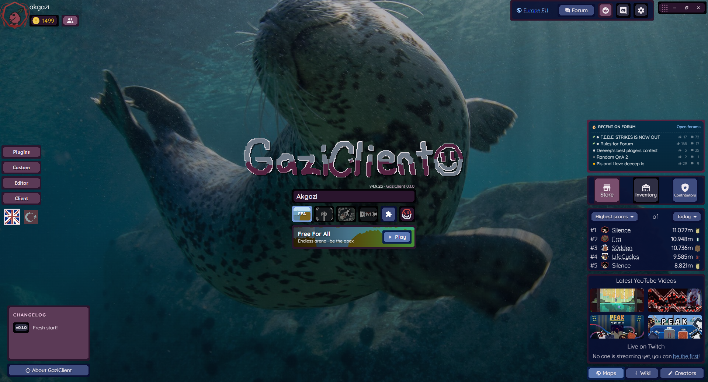
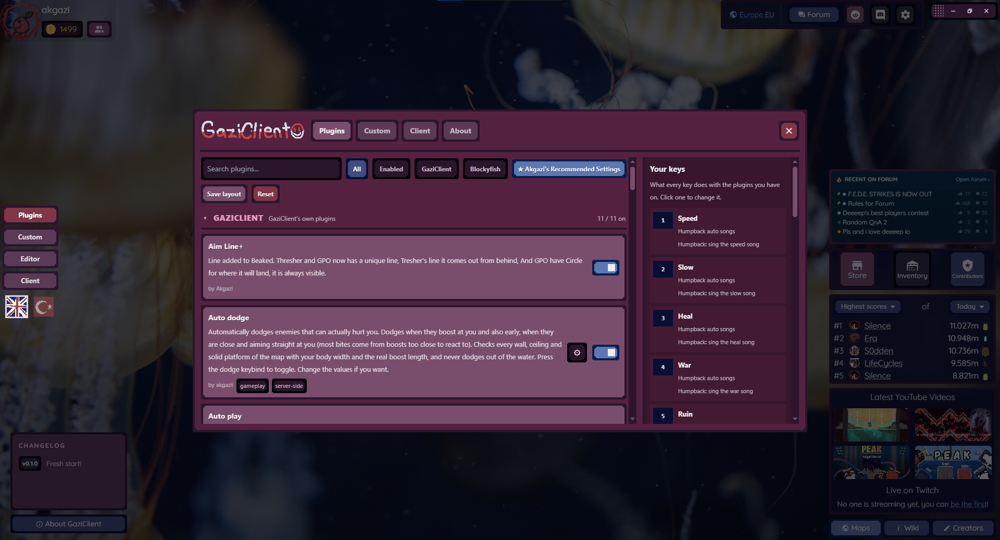
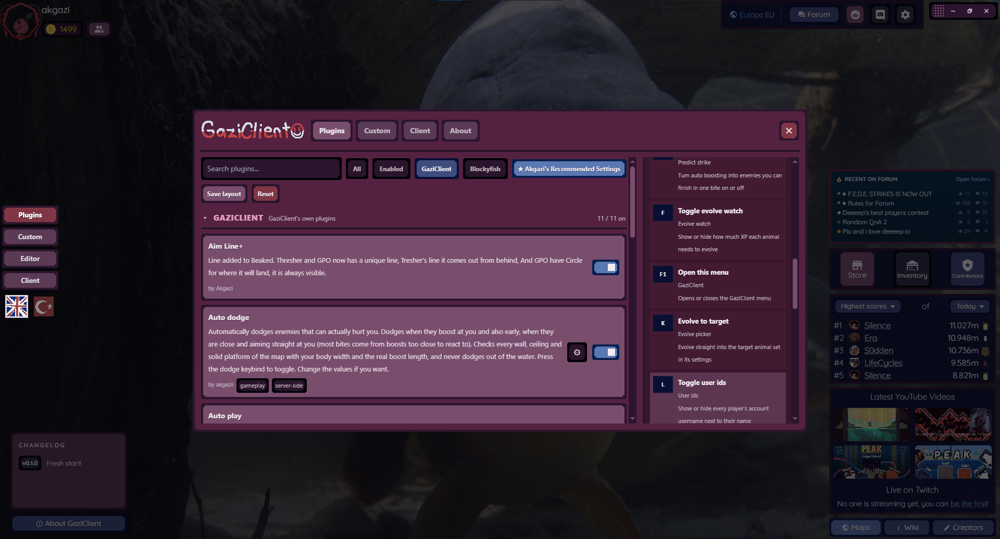
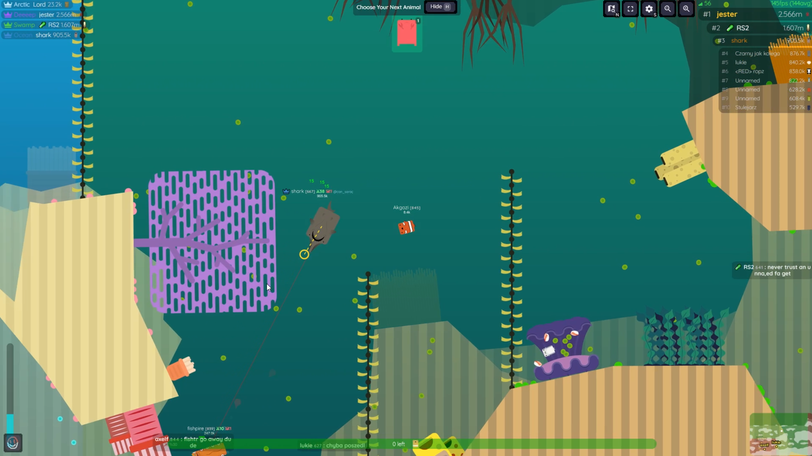
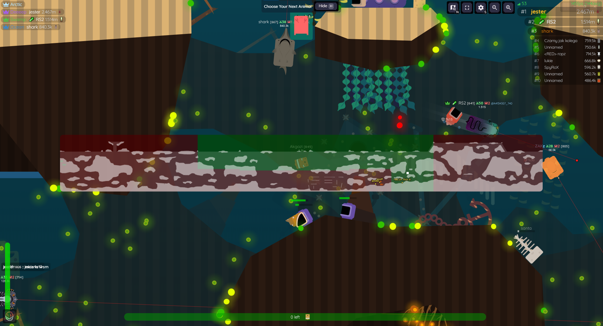
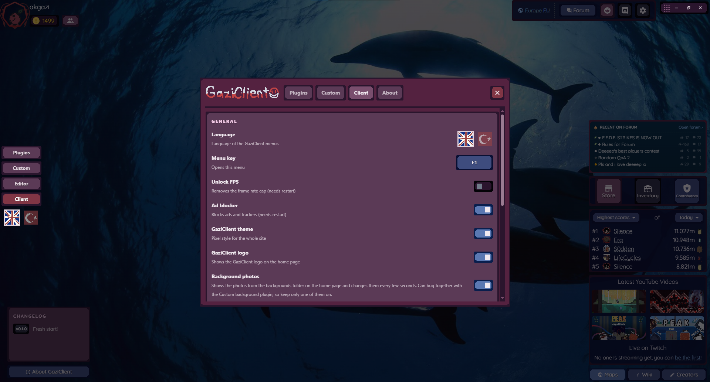
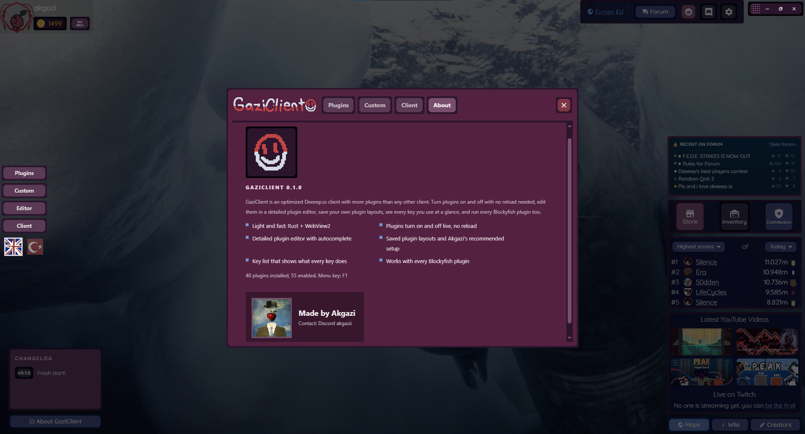

GaziClient

an unofficial deeeep.io client for windows and android. i made it because i wanted more plugins than the other clients have, and because reloading the whole game every time you turn a plugin on or off was annoying.



this is the home page. the buttons on the left open the menu tabs, the flags switch the language (english / turkish), and the box at the bottom shows whats new.



the plugins tab. every plugin turns on and off live, no reload. on the right theres a list of every key you use and what it does, so you dont forget which key was what. if two plugins use the same key it shows that too.



- 40 plugins: 11 of mine and 29 from blockyfish
- turn plugins on and off without reloading the game
- "Akgazi's Recommended Settings" button, turns on the plugins i use with my keys. everything is off on a fresh install
- save your own plugin layouts and load them with one click, or reset everything
- plugin editor with autocomplete (desktop only)
- ad blocker, pixel theme, home page backgrounds, menu opacity, zoom
- english and turkish
- android app with on-screen buttons you can move around

my plugins: Kill calc, Aim Line+, Auto dodge, Auto play, Chat radar, Emote picker, Evolve picker, Evolve watch, Predict strike, Thresher kit, User ids



predict strike aiming at a shark (the yellow ring is where it will be), with kill calc and user ids next to the names.







## download

go to [releases](../../releases) and get:

- `GaziClient.exe` for windows 10/11. no installer, just run it. it uses webview2 which windows already has
- `GaziClient-x.x.x.apk` for android. you need to allow "install unknown apps" for your browser or file manager

windows might show a smartscreen warning the first time because the exe isnt signed with a paid certificate. click "more info" then "run anyway". if you dont trust it, read the next part.

## its open source

all the code is here, you can read every line before running anything. the exe and apk in releases are built by github actions straight from this repo (see `.github/workflows/release.yml`), not on my pc, so what you download is exactly this code. every release has a `SHA256SUMS.txt`, and you can check a file was built here with:

```
gh attestation verify GaziClient.exe --repo akgazii/GaziClient
```

GaziClient doesnt download any plugin code from the internet. every plugin is inside the exe/apk and you can see them in `plugins/`. the only things it fetches are game data from deeeep.io itself (animal list, skins, emotes, usernames).

## android

same client, same plugins, same menu. since phones have no keyboard every key of the plugins you turned on gets a button on the screen. open the menu (GaziClient button), go to Client > Mobile buttons > Edit button layout, then drag the buttons wherever you want. tap a button to hide it, Done saves it. you can also change the button size there.

stuff that needs a mouse (ctrl + click plugins like boost hack and thresher kit) doesnt really work on a phone, and theres no plugin editor on mobile.

## keys

menu key is F1 (you can change it). plugin keys are all in the "your keys" list in the plugins tab, click one to change it. Esc pauses auto dodge and execute until you press Esc again, handy when you go afk.

## build it yourself

windows, you need rust (msvc):

```
cargo build --release
```

the exe ends up in `target\release\gaziclient.exe`.

android, you need jdk 17 and the android sdk (platform 34 + build-tools 34.0.0), no android studio or gradle:

```
powershell -ExecutionPolicy Bypass -File android\build.ps1
```

it builds the exe first and takes the runtime and plugins from it, so desktop and mobile always have the same code. the first run makes a signing key in `%USERPROFILE%\.gaziclient`, back that folder up.

## blockyfish plugins

the 29 plugins in `plugins/blockyfish/` are made by the blockyfish devs, not me. they are included so they keep working in GaziClient, they are not under my license and all credit goes to them. thanks blockyfish

## license

GPL-3.0 with one extra rule (see `LICENSE` and `NOTICE.md`):

- you can use my code in your own project if your project is open source too and you credit GaziClient where people can see it
- open source without credit is not allowed
- closed source is not allowed

## note

this is not made by or affiliated with deeeep.io. some plugins play for you or dodge for you, using them can get you banned, so its on you.

made by akgazi, discord: akgazii
